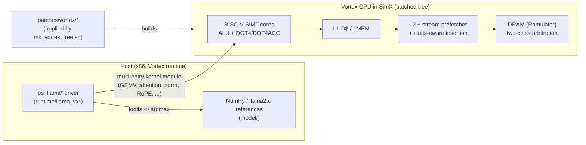

# PhaseShift


-orange)


**PhaseShift studies what a small open-source GPU needs to run LLM token decode well.** It extends the
[Vortex](https://github.com/vortexgpgpu/vortex) RISC-V GPGPU with a full llama2.c-compatible decode runtime, a set of
hand-tuned decode kernels, phase-aware memory-system mechanisms and an int8 `DOT4` instruction, and measures all of
it cycle by cycle in Vortex's SimX simulator. The headline result: a single 4-way int8 dot-product instruction plus a
warp-cooperative GEMV kernel makes batch-1 Q8_0 decode GEMV about **2-2.7x faster** than the same-layout scalar
kernel and end-to-end token decode **+16-28 % faster** than the best software baseline, at a fraction of the area of
Vortex's tensor core.

## Highlights

- **DOT4 / DOT4ACC** int8 dot-product instructions (RISC-V custom-3 opcode) in SimX, plus a synthesis-only RTL
  datapath for area estimates.
- **Warp-cooperative Q8_0 GEMV** with a coalescing weight re-layout, bit-exact with llama2.c's `runq.c`.
- **Full-model decode on the device** (`runtime/llama_vx*`): every op of llama2.c's forward pass runs as a Vortex
  kernel (RMSNorm, RoPE + KV write, fused GQA decode attention, GEMV, SiLU gate, residual), token-exact against
  llama2.c.
- **Phase-aware memory mechanisms** as SimX patches: request classes and hints, KV-aware L2 insertion/bypass,
  two-class DRAM arbitration, DXA stream classes, per-launch L2 way masks, schedule replay and phase counters, each
  with phase-ignorant baselines.
- **Analytical models** (`model/`): roofline, memory-hierarchy model calibrated against SimX, oracle schedule search,
  and a serving-level discrete-event simulator (`serving/`).
- **Vortex errata** ([`docs/vortex_errata.md`](docs/vortex_errata.md)): 40 documented doc/code mismatches and
  simulator behaviours, including a SimX cache-bank ordering defect and its fix.

## Architecture



Per decode token and layer the driver launches: `rmsnorm -> q,k,v GEMV -> rope_kv (RoPE + KV-cache write) -> decode
attention -> o GEMV -> residual -> rmsnorm -> w1,w3 GEMV -> silu_gate -> w2 GEMV -> residual`, then the final norm
and the classifier GEMV.

## Repository layout

```text
phaseshift/
├── kernels/            Vortex device kernels + host apps (GEMV variants, attention, element-wise, microbenchmarks)
│   ├── ps_gemv_q80dot4w/   warp-cooperative DOT4 Q8_0 GEMV
│   ├── ps_gemv_q80tcu*/    int8 tensor-core GEMV baselines
│   ├── decode_attn_gqa/    fused GQA decode attention
│   └── common/             shared headers (Q8_0 helpers, hints, phase DCRs, way masks)
├── runtime/            full-model llama2.c decode drivers (llama_vx, llama_vx_dot, ..._dot2, ..._dot3, ..._dot4att)
├── patches/
│   ├── vortex/infra        build fixes (both trees)
│   ├── vortex/base         SimX cache-ordering fix (base tree)
│   ├── vortex/ps           PhaseShift mechanisms (ps tree)
│   ├── vortex/dot4         DOT4/DOT4ACC in SimX            (optional --extra)
│   ├── vortex/prefetch     L2 stream prefetcher + stats    (optional --extra)
│   ├── vortex/fflags       FFLAGS scoreboard fix           (optional --extra)
│   ├── vortex/rtl          synthesis-only RTL (DOT4 datapath, prefetch unit, synth tops)
│   └── llama2c/            token-id recording for the llama2.c golden runs
├── scripts/            tree/build/run tooling: mk_vortex_tree.sh, build_vortex.sh, install_kernel_apps.sh, vxrun.py, lowload.sh
├── model/              references and analytical models (llama2.c NumPy reference, Q8_0, roofline, memhier, oracle)
├── serving/            iteration scheduler and discrete-event serving simulator
├── experiments/        named SimX machine configurations (configs.yaml), knob and regression lists
├── tests/              pytest suite (Vortex-marked tests run only with PS_RUN_VORTEX=1)
├── configs/, data/     pinned model-config lock and data manifest (files are fetched, not committed)
├── third_party/LOCK    pinned upstream commits (Vortex, llama2.c, submodules)
├── docs/               methodology.md (every equation and modeling choice), vortex_errata.md
└── RESULTS.md          results summary
```

## Quickstart

Requirements: Linux, conda, git, a C++17 compiler, and the Vortex RISC-V toolchain installed under `~/tools`
(the upstream Vortex toolchain install; `build_vortex.sh` configures with `--tooldir=$HOME/tools`). The scripts are
written for a low-memory machine: heavy steps run serially through `scripts/lowload.sh`.

```bash
# 1. Python environment
conda env create -f phaseshift/environment.yml
conda activate phaseshift

# 2. Pinned upstream sources (commits from third_party/LOCK)
git clone https://github.com/vortexgpgpu/vortex.git phaseshift/third_party/vortex
git -C phaseshift/third_party/vortex checkout 50cb174546ec69a3869b42b8871e932e4440511f
git -C phaseshift/third_party/vortex submodule update --init --recursive
git clone https://github.com/karpathy/llama2.c phaseshift/third_party/llama2.c
git -C phaseshift/third_party/llama2.c checkout 350e04fe35433e6d2941dce5a1f53308f87058eb

# 3. Shell environment (sets $PS, $LL, build dirs, single-threaded make)
source phaseshift/scripts/env.sh
cd "$PS"

# 4. A patched Vortex tree with DOT4, then its build and the out-of-tree apps
scripts/mk_vortex_tree.sh --patchset ps --name psdotw --extra dot4
scripts/build_vortex.sh psdotw            # configure + third_party + software
scripts/install_kernel_apps.sh build/vortex-psdotw
```

Other trees: `--patchset base` (upstream + build fixes + ordering fix) and
`--patchset ps --name psall --extra dot4 --extra prefetch --extra fflags` (everything).

### Run a DOT4 GEMV (one SimX run)

```bash
python scripts/vxrun.py run --step demo --tree psdotw --app ps_gemv_q80dot4w \
    --config BS-T5-dot4lat3 --args "-m 768 -n 288 -G 32 -B 1 -v w1u1 -L 1"
```

`BS-T5-dot4lat3` is the short-latency machine with DOT4 at latency 3; `BS2-lat190` is the long-latency one. The run
appends one JSON row (cycles, instructions, checks) to `results/demo/rows.jsonl`.

### Decode tokens with the full-model driver

```bash
scripts/fetch_models.sh                                           # pinned tinyllamas checkpoints -> data/models/
$LL --rss 0.5 --mem 2 --label llama2c -- \
    bash -c 'scripts/build_llama2c.sh && scripts/golden_llama2c.sh'   # llama2.c reference binaries + golden token ids
mkdir -p build/models
python third_party/llama2.c/export.py build/models/stories15M_q80.bin \
    --version 2 --checkpoint data/models/stories15M.pt               # Q8_0 export (version 2)
python scripts/vxrun.py run --step demo --tree psdotw --app ps_llamadot3 --config BS-T5-dot4lat3 \
    --args "-w $PS/build/models/stories15M_q80.bin -T $PS/results/S8/golden_tokens_15M.txt -m tf -n 8 -q q80"
```

`-m tf` teacher-forces the golden sequence and checks every argmax; `-n` is the number of positions. Expect long
simulation times for many positions.

### Tests

```bash
python -m pytest -q -m "not vortex"          # light tests (no simulator)
PS_RUN_VORTEX=1 python -m pytest -q          # also the SimX tests (needs built trees; slow)
```

Some tests validate stored experiment outputs under `results/`; those outputs are not part of this snapshot, so the
tests skip (or are not collected) until the corresponding runs exist.

## Results

See **[RESULTS.md](RESULTS.md)**. In short (SimX, Q8_0, single deterministic runs):

| | short-latency | long-latency | 2 cores / 1 channel |
|---|---|---|---|
| DOT4 GEMV vs same-layout scalar (geomean) | 2.7x | 1.9x | |
| DOT4 GEMV vs best software GEMV | | +100 % | +92 % |
| stories15M token decode at position 128 vs best software | +28 % | +16 % | +16 % |

DOT4 beats an equal-effort tuned int8 tensor-core GEMV by 1.32-1.34x at batch 1 (parity at batch 2, slower at
batch 4) with about 8-10x less area (synthesis ratios).

## Documentation

- [`docs/methodology.md`](docs/methodology.md): notation, first-principles equations, baselines, measurement
  conventions, kernel and mechanism semantics. A working research document: some sections describe studies whose
  data is not in this snapshot.
- [`docs/vortex_errata.md`](docs/vortex_errata.md): Vortex documentation/code mismatches with file:line evidence.

## Acknowledgements

PhaseShift is built on [Vortex](https://github.com/vortexgpgpu/vortex) (Apache-2.0), pinned at commit
`50cb174546ec69a3869b42b8871e932e4440511f`, and on its bundled third-party components listed in
[`third_party/LOCK`](third_party/LOCK). If you use this work, please cite Vortex as its authors request in the
upstream repository. The decode reference is [llama2.c](https://github.com/karpathy/llama2.c) (MIT) with the
tinyllamas checkpoints.

## Status

Research snapshot. Interfaces, kernel variants and scripts reflect an active study and are not a stable API.
All results are cycle-level simulation (SimX) with synthesis area ratios; see [RESULTS.md](RESULTS.md) for caveats.
PhaseShift code is released under the Apache-2.0 license; upstream components keep their own licenses.
